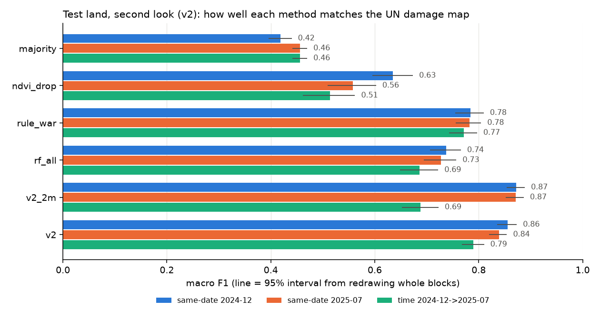
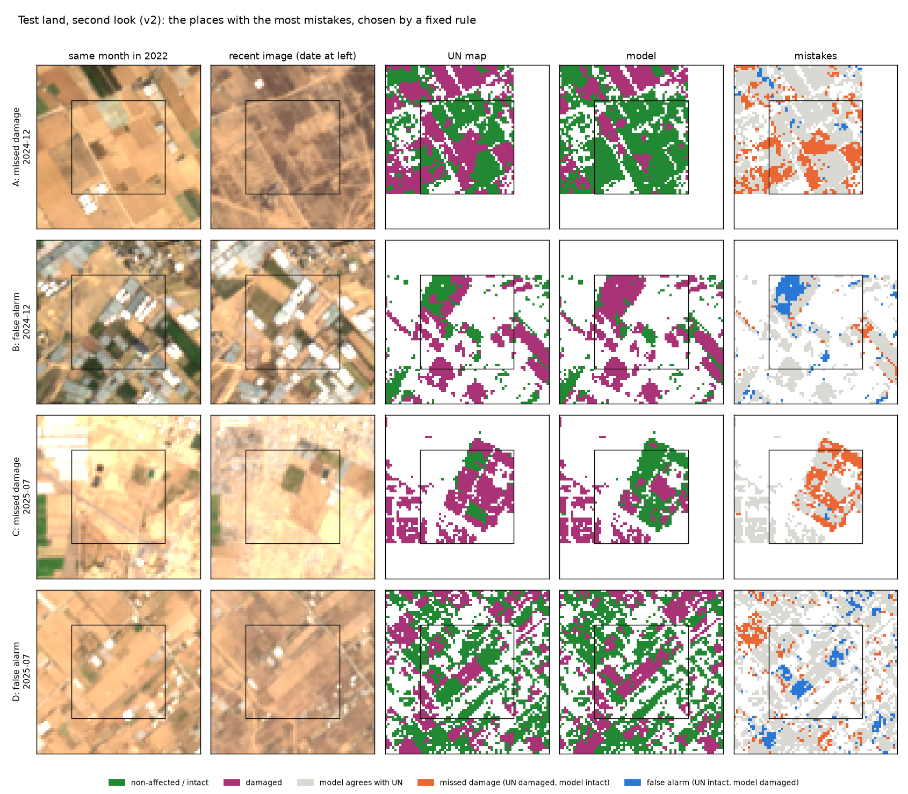

# The Day After

**Which farmland in Gaza could feed people first after a ceasefire?** Satellite AI, checked against UN expert damage maps.

**Track:** AI + Climate · **Team:** Russell Ghanayem (solo) · Veritas AI International High School Hackathon 2026

- **Try it:** https://huggingface.co/spaces/russellbuilds/the-day-after (runs in the browser, including the trained model)
- **Notebook with all outputs:** [`notebooks/report.ipynb`](notebooks/report.ipynb)
- **Demo video:** VIDEO_LINK

*This project is a prototype, not agricultural or humanitarian advice.*

## The problem
After a ceasefire, aid agronomists (FAO, NGOs) must choose which fields to help first, with limited seeds, water and staff. Khan Younis governorate has the most cropland in the Gaza Strip (4,278 of 15,052 ha; FAO, 2025). By July 2025, UN analysts had marked 82% of it as damaged (UNOSAT-FAO). There are thousands of fields, and they cannot all be checked at once. A good shortlist on day one would tell field teams where to look first.

## What we built
- **In:** a month, from October 2023 to October 2026.
- **Out:** for each of 7,613 one-hectare plots of farmland: how much of it the AI estimates was damaged, a status (intact, partly or mostly damaged), a recovery priority, a one-line reason and a suggested first step. Plus maps, hectares by status, and a ranked list to download. The shortlist can be shown in Arabic and printed as a one-page field sheet for teams with no internet.
- **For whom:** an aid agronomist planning field visits. They pick the month and decide how much damage should count against a plot.

## What we added
The brief (land-use mapping from satellite images) asks for a classifier. We added:
- **A real user and decision:** which fields to visit first, not a land-cover map.
- **An expert answer key:** 18 monthly UN damage maps instead of hand-made labels.
- **A second, transparent layer:** a planner that turns damage and pre-war productivity into a shortlist with reasons.
- **Ways to check us:** test rules published before each test, a test on a governorate the model never saw, and a web page that runs the trained model in your browser on test land.

## How it works
- **Data:** one cloud-free Sentinel-2 picture per month, January 2017 to October 2026 (118 months, 10 m pixels). UNOSAT-FAO damage maps are the labels. ESA WorldCover 2021 says what was orchard before the war.
- **The idea:** every field has its own rhythm, green in the growing season and brown after harvest. For each pixel and each calendar month we compute its **normal** from 2017 to 2022. Damage shows as months far below that normal.
- **The model:** gradient-boosted decision trees (LightGBM, 400 trees) on 61 features: how far the pixel is below its normal now, 1 to 6 months back, over the last 3, 6 and 12 months, and since October 2023. It learned from 18 UN maps on training land.
- **No leakage:** the land is cut into 1 km blocks. 40 blocks were locked away for testing, and training pixels within 100 m of them were dropped.
- **The planner (plain rules, not AI):** priority = pre-war productivity × (1 − penalty × damaged share). The penalty is the user's choice.

## Results
Scores are macro F1 (0 to 1), on land the model never saw. Brackets are 95% ranges from a block bootstrap.

| Method | Khan Younis, Dec 2024 | Khan Younis, Jul 2025 | Forward in time¹ | Deir al-Balah², Dec 2024 | Deir al-Balah², Jul 2025 |
|---|---|---|---|---|---|
| Always "damaged" | 0.42 | 0.46 | 0.46 | 0.43 | 0.46 |
| Rule: greenness drop vs same month of 2022 | 0.63 | 0.56 | 0.51 | 0.64 | 0.63 |
| First model (v1, one month of images) | 0.74 | 0.73 | 0.69 | 0.75 | 0.78 |
| Rule: worst monthly drop since Oct 2023 | 0.78 | 0.78 | 0.77 | 0.80 | 0.82 |
| **Our model (v2, season history)** | **0.86** (0.84 to 0.87) | **0.84** (0.82 to 0.85) | **0.79** (0.77 to 0.81) | **0.85** (0.84 to 0.86) | **0.87** (0.86 to 0.87) |

¹ Learn from UN maps up to Dec 2024, judge Jul 2025, on Khan Younis test land. ² A second governorate. No Deir al-Balah data were used to choose, fit, calibrate or set thresholds for any model; the frozen models were scored there once.

- **It beats the baselines.** v2 is ahead of the season rule by +0.07 and +0.06 in Khan Younis and +0.05 and +0.05 in Deir al-Balah. Every one of those ranges is above zero.
- **Looking forward in time the lead is small.** In Khan Younis it is +0.02 (range -0.002 to +0.041), which includes zero, so we do not claim a win there. In Deir al-Balah it is +0.02 (range +0.011 to +0.030).
- **The right information matters as much as the model.** A one-line rule that uses the season history (0.78) already beats our whole first model (0.74). Learning adds the rest.
- **At the planner's unit,** the status of a 1-hectare plot matches the UN map for 84% and 87% of plots (first model: 72% and 80%).
- **Does the shortlist point to good land?** In the top-ranked 10% of plots, 43% (Dec 2024) and 21% (Jul 2025) of the cropland is intact according to the UN map. Ranking by productivity alone gives 9% and 3%. A ranking made from the UN map itself gives 52% and 25%.
- **By plain accuracy the margin is smaller:** v2 91% against 84% for always answering "damaged" (Jul 2025). That answer finds no intact land; v2 finds 76% of it.



### Where it fails


- **Field borders.** 27% of border pixels are wrong, against 5% inside fields (Dec 2024). The UN maps are drawn on a 5 m grid and the satellite sees 10 m pixels, so a border pixel mixes two answers.
- **Bare land that is intact** is often called damaged, and land that was hardly green before the war gives no drop to detect (example C above).
- **Greenhouses and sheds** (example B): greenness fell at some point, the UN map says not affected.
- **Finding intact land is the hard part.** When v2 says "intact" in July 2025, the UN agrees 71% of the time. When it says "damaged", 95%.
- **Our first model failed on fields that are bare every December or July.** That is why v2 uses the whole season. In the four places where v1 failed worst, mistakes fell from 764, 168, 712, 310 to 131, 44, 184, 119.
- **In Deir al-Balah it overestimates damage in Dec 2024** (2,082 ha against the UN's 1,941 ha).

### How we kept it honest
- Test rules were written and pushed **before** each test: [`docs/test_plan.md`](docs/test_plan.md), [`docs/test_plan_v2.md`](docs/test_plan_v2.md), [`docs/test_plan_region.md`](docs/test_plan_region.md). Each test script refuses to run twice and records the code version.
- The Khan Younis test land was scored twice (v1, then v2), and v2 was partly inspired by v1's mistakes there. Deir al-Balah is the fresh check.
- We departed from our own model-selection rule once, on training land, and wrote down why before the test.
- A second AI (OpenAI Codex) recomputed every test number from the saved answers. All matched.
- The UN maps are a reference, not ground truth. They were made from the same satellite's greenness, and "damaged" stays once marked. Our hectare figure for March 2025 matches FAO's published one (75.9% against 75.5%).

## Why this could help
Suppose a field team can only visit the top-ranked 10% of plots (228 of the 2,284 test plots). How much intact farmland, by the UN map, would they reach?

| How the plots are chosen | Dec 2024 | Jul 2025 |
|---|---|---|
| Most productive land first, with no damage map | 13 ha | 4 ha |
| **Our shortlist** | **59 ha** | **29 ha** |
| Best possible, using the UN map itself | 71 ha | 34 ha |

With the same number of visits, the shortlist reaches 4.5 times (Dec 2024) and 7.7 times (Jul 2025) more intact farmland than ranking by productivity alone, and 84% and 85% of the best possible. The most productive land was hit hardest, so without a damage map the first visits would go almost entirely to damaged fields. This is measured on test land, with the UN map as the reference. It says nothing about access or safety.

## What we would do next
- Sharper images (the answer key is on a 5 m grid) and radar, which sees through clouds.
- More governorates, and field checks with people who know the land.
- Add what the tool cannot see: access, safety, water and soil.
- Look back in time: the same method on older Landsat images could measure how long farmland took to recover after earlier conflicts. Sentinel-2, the satellite we use, only started in 2015.

## Limits
The tool does not know whether land is safe or reachable, who owns it, its soil or water, or what farmers want to grow. Months after July 2025 have no UN map to check against. It gives a shortlist for field teams, not a decision.

## Sources
**Data**
- Copernicus Sentinel-2 L2A (European Space Agency), accessed through the Microsoft Planetary Computer. Contains modified Copernicus Sentinel data, 2017-2026.
- UNOSAT and FAO, *Gaza Strip Cropland Damage Assessment* geodatabase (July 2025 release, 18 monthly maps), Humanitarian Data Exchange, CC BY-SA.
- ESA WorldCover 2021 v200 (Zanaga et al., 2022), CC BY 4.0.
- OCHA COD-AB administrative boundaries for the occupied Palestinian territory, Humanitarian Data Exchange.
- FAO (2025), *Land availability for cultivation in the Gaza Strip as of April 2025*, CD5442EN/1/05.25, CC BY 4.0. Used for the cropland totals above and to cross-check our hectares.

**Software:** Python, NumPy, pandas, GeoPandas, Shapely, pyproj, rasterio, rioxarray, xarray, affine, pyogrio, odc-stac, odc-geo, pystac-client, planetary-computer, scikit-learn, LightGBM, SciPy, joblib, matplotlib, Pillow, markdown-it-py, nbformat, nbclient, Jupyter, Gradio, huggingface_hub, pypdf. Exact versions are in `requirements-lock.txt`.

**AI tools:** Claude Code (Anthropic; Claude Fable 5.2, Opus 5.5 and Sonnet 5.5) wrote most of the code with me and explained each part. OpenAI Codex reviewed the code and recomputed the test numbers. The Arabic shortlist was translated by Claude and reviewed by Codex; no professional translator has checked it, and the page says so. Every step and every decision of mine is in [`docs/ai_log.md`](docs/ai_log.md), and plain-words explanations of each phase are in [`docs/explainers.md`](docs/explainers.md).

## Run it yourself
```
python -m venv .venv && .venv/Scripts/pip install -r requirements-lock.txt
.venv/Scripts/python -I src/01_labels.py            # UN labels and the governorate outline
.venv/Scripts/python -I src/02_imagery.py           # first composites
.venv/Scripts/python -I src/02b_monthly.py          # 118 monthly pictures
.venv/Scripts/python -I src/01b_label_history.py && .venv/Scripts/python -I src/01c_labels_monthly.py
.venv/Scripts/python -I src/03_features.py && .venv/Scripts/python -I src/04_split.py && .venv/Scripts/python -I src/03b_features_v2.py
.venv/Scripts/python -I tests/test_no_leakage.py    # 14 automatic leakage checks
.venv/Scripts/python -I src/05_train_eval.py cv     # first model; then: fit, calibrate
.venv/Scripts/python -I src/05c_train_v2.py cv      # season-history model; then: choose, exams, fit, rehearse
.venv/Scripts/python -I src/06_planner.py           # the shortlist
```
The test steps (`src/05b_test.py`, `src/09_region_test.py`) were each run once and refuse to run again; their saved answers are in `results/`. The web page is in `web/` and is checked by `tests/test_web.py`.

*This project is a prototype, not agricultural or humanitarian advice.*
